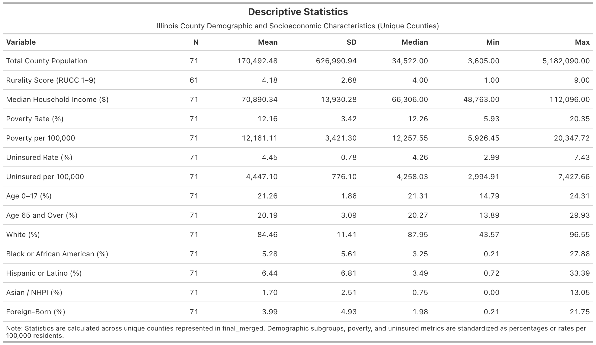
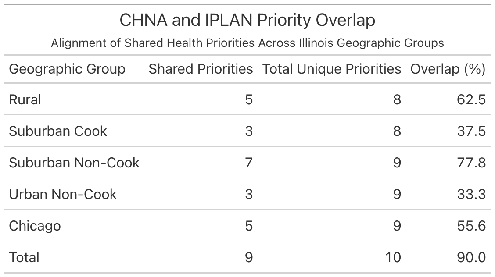
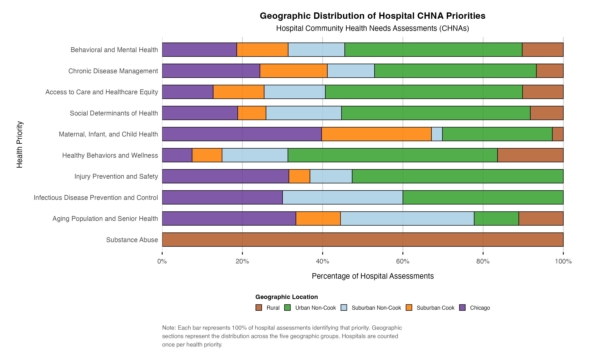
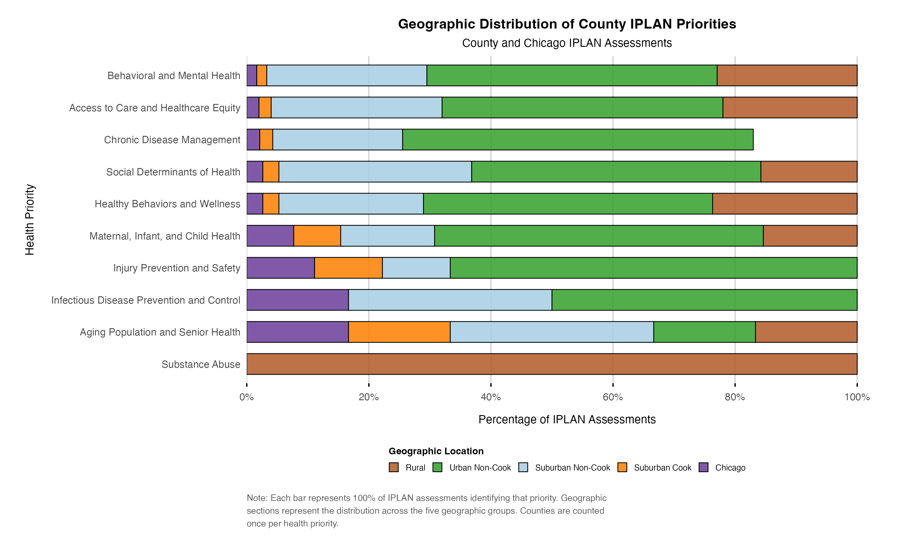
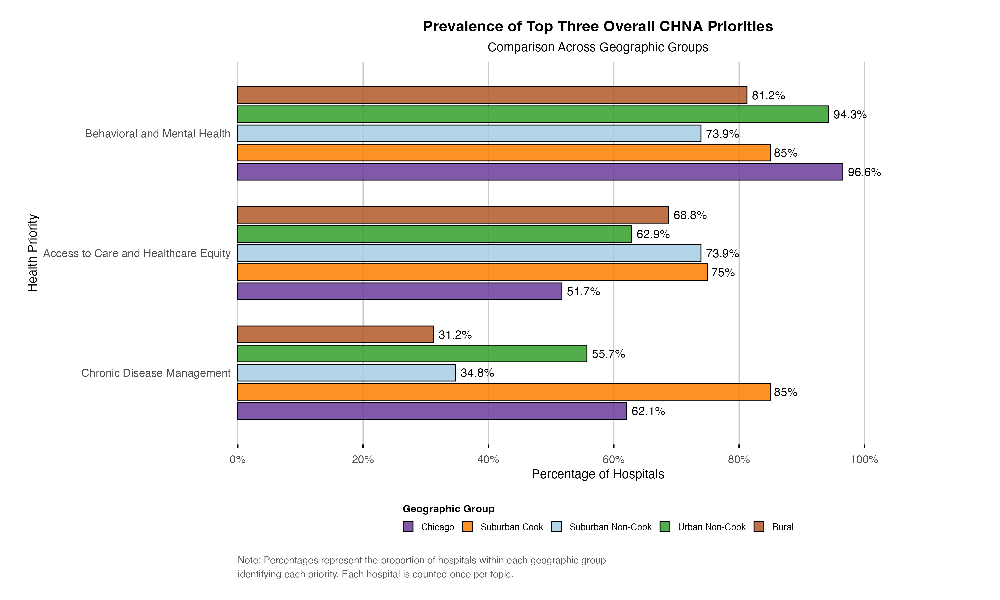
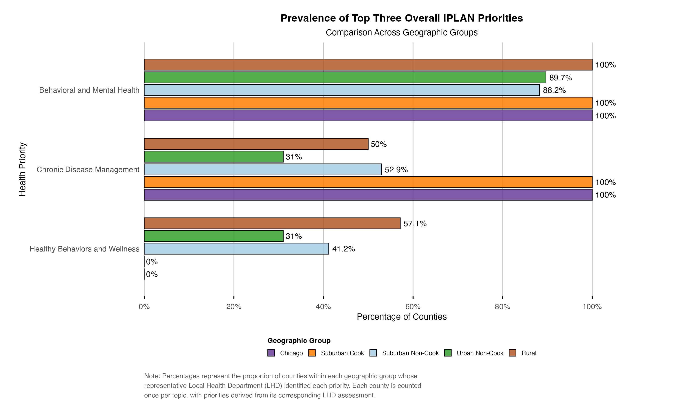
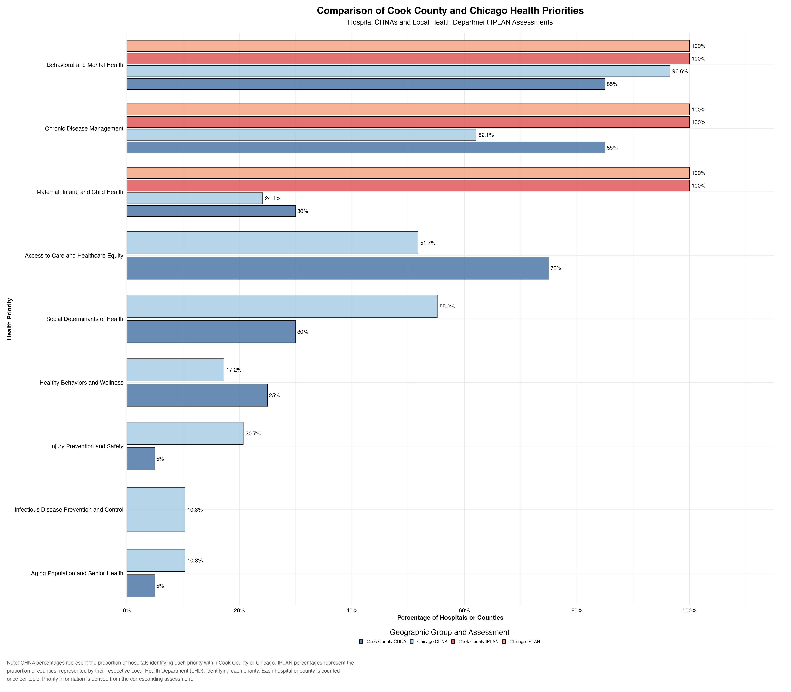
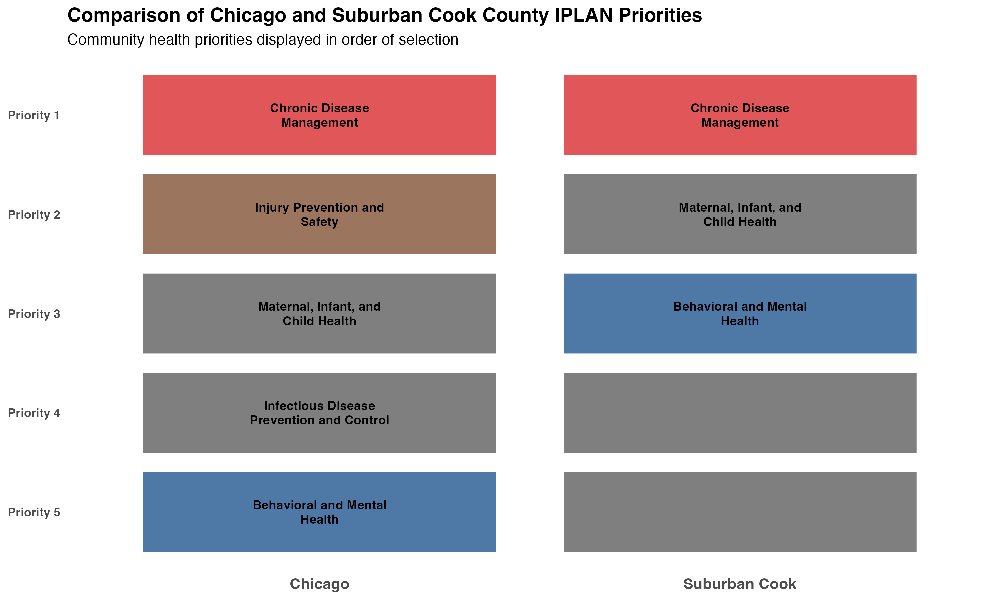
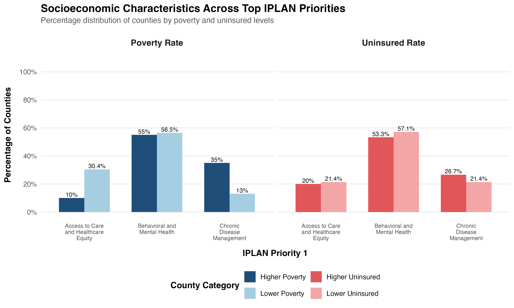

# Illinois County Public Health Analysis

This section presents a collection of data visualizations examining hospital Community Health Needs Assessments (CHNAs), local health department Illinois Project for Local Assessment of Needs (IPLAN) priorities, and demographic and socioeconomic characteristics across Illinois. Analyses are organized across five geographic groups: Chicago, Suburban Cook, Suburban Non-Cook, Urban Non-Cook, and Rural.

Using hospital assessment data, local health department priorities, U.S. Census Bureau American Community Survey (ACS) estimates, and geographic classifications, these analyses examine alignment between healthcare institutions and local public health departments. Interactive graphs, statistical comparisons, and geographic visualizations highlight differences in community health priorities, population characteristics, and socioeconomic conditions to inform public health planning and policy decisions.

## Variable Descriptive Statistics

**Methods:** Descriptive statistics were calculated for county-level demographic, socioeconomic, and healthcare access indicators. Measures included sample size, mean, standard deviation, median, minimum, and maximum.

**Interpretation:** The average county poverty rate was approximately 12%, with a median of 13%. Mean median household income was approximately $79,491. County population showed substantial variation, with the mean considerably higher than the median, reflecting the influence of highly populated areas.

## CHNA and IPLAN Priority Alignment Across Geographic Groups

**Methods:** Hospital CHNA and local health department IPLAN priorities were standardized into common health topic categories and compared across five geographic groups. Shared priorities were identified within each group. Alignment was calculated as the number of shared priorities divided by the total number of unique priorities, multiplied by 100.

**Interpretation:** Overall, CHNA and IPLAN assessments shared 9 of 10 unique health priorities statewide, representing 90% overlap. Suburban Non-Cook demonstrated the highest alignment (77.8%), followed by Rural (62.5%) and Chicago (55.6%). Suburban Cook (37.5%) and Urban Non-Cook (33.3%) demonstrated the lowest alignment. Although statewide alignment was high, differences across geographic groups suggest that hospitals and local health departments do not always identify the same community health needs.

## First-Ranked Hospital CHNA Priorities Across Geographic Groups

<iframe
  src="chna.html"
  width="100%"
  height="700"
  style="border: none;">
</iframe>

**Methods:** Hospital CHNA first-ranked priorities were examined across the five geographic groups. The number of hospitals identifying each health topic as their highest-ranked priority was calculated and compared by geographic location.

**Interpretation:** Behavioral and Mental Health was the leading first-ranked hospital priority in Chicago (12 hospitals), Suburban Cook (10), and Urban Non-Cook (31). Rural hospitals were divided between Behavioral and Mental Health and Access to Care and Healthcare Equity (6 each). Suburban Non-Cook hospitals identified Access to Care and Healthcare Equity as their leading first-ranked priority (11 hospitals). These findings demonstrate geographic variation in the primary health needs emphasized by hospitals.

## First-Ranked County IPLAN Priorities Across Geographic Groups

<iframe
  src="iplan.html"
  width="100%"
  height="700"
  style="border: none;">
</iframe>

**Methods:** First-ranked IPLAN priorities were examined across the five geographic groups. The frequency of each leading health topic was calculated to identify differences in the primary priorities selected by local health departments.

**Interpretation:** Behavioral and Mental Health was the leading first-ranked priority in Urban Non-Cook (10 assessments), Suburban Non-Cook (7), and Rural jurisdictions (7). In contrast, Chicago and Suburban Cook identified Chronic Disease Management as their first-ranked priority. These findings demonstrate differences between hospital and public health department priorities across geographic areas.

## Geographic Distribution of Hospital CHNA Priorities

**Methods:** Hospital CHNA priorities were grouped by geographic location and standardized across ten health topic categories. The proportion of hospital assessments identifying each priority was calculated within each topic to examine its geographic distribution.

**Interpretation:** The geographic distribution of hospital priorities varied by health topic. Behavioral and Mental Health and Chronic Disease Management were represented across multiple geographic groups. Substance Abuse was exclusively represented in rural hospital assessments. Other topics, including Maternal, Infant, and Child Health and Injury Prevention and Safety, also demonstrated differences in geographic representation.

## Geographic Distribution of County IPLAN Priorities

**Methods:** County and Chicago IPLAN priorities were grouped into the five geographic classifications. The proportion of IPLAN assessments identifying each health topic was calculated to examine the geographic distribution of reported priorities.

**Interpretation:** Substance Abuse was exclusively represented in rural IPLAN assessments. Urban and suburban jurisdictions contributed substantially to priorities such as Infectious Disease Prevention and Control, Injury Prevention and Safety, and Social Determinants of Health. These findings illustrate how local public health priorities vary across geographic settings.

## Prevalence of Top Three Overall CHNA Health Priorities

**Methods:** Three frequently identified hospital CHNA priorities were selected for comparison: Behavioral and Mental Health, Access to Care and Healthcare Equity, and Chronic Disease Management. The percentage of hospitals identifying each priority was calculated within each geographic group.

**Interpretation:** Behavioral and Mental Health demonstrated consistently high prevalence across all geographic groups, ranging from 73.9% in Suburban Non-Cook to 96.6% in Chicago. Chronic Disease Management showed considerable geographic variation, with the highest prevalence in Suburban Cook (85.0%) and the lowest in Rural areas (31.2%). Access to Care and Healthcare Equity was also commonly identified, although its prevalence varied across regions.

## Prevalence of Top Three Overall IPLAN Health Priorities

**Methods:** Three frequently identified IPLAN priorities were examined across geographic groups: Behavioral and Mental Health, Chronic Disease Management, and Healthy Behaviors and Wellness. The percentage of local health department assessments identifying each priority was calculated within each group.

**Interpretation:** Behavioral and Mental Health and Chronic Disease Management were identified in 100% of both Chicago and Suburban Cook IPLAN assessments. Behavioral and Mental Health was also prevalent in Rural (100%), Suburban Non-Cook (88.2%), and Urban Non-Cook (89.7%) jurisdictions. Healthy Behaviors and Wellness was most frequently identified in Rural jurisdictions (57.1%), followed by Suburban Non-Cook (41.2%).

**Data consideration:** Chicago and Suburban Cook each have one IPLAN observation, so their percentages represent individual assessments rather than broader jurisdictional patterns.

## Comparison of Cook County and Chicago Health Priorities

**Methods:** Hospital CHNA priorities were compared with local health department IPLAN priorities in Chicago and Suburban Cook. Chicago hospital assessments were compared with the Chicago Department of Public Health (CDPH) IPLAN, while Cook County hospital assessments outside Chicago were compared with the Cook County Department of Public Health (CCDPH) IPLAN. The percentage of assessments identifying each health topic was calculated to examine institutional differences.

**Interpretation:** Hospital and public health department assessments demonstrated alignment in Behavioral and Mental Health and Chronic Disease Management. However, hospitals placed additional emphasis on Access to Care and Healthcare Equity and Social Determinants of Health. Access to Care reached approximately 75% among hospital assessments, while Social Determinants of Health reached approximately 55.2%. These priorities were not represented in the municipal IPLAN frameworks, highlighting differences in the health needs emphasized by clinical institutions and local public health departments.

## Ordered Comparison of Chicago and Suburban Cook County IPLAN Priorities

**Methods:** The five ranked IPLAN priorities selected by the Chicago Department of Public Health and Cook County Department of Public Health were compared in their original order of selection. Each priority was organized by rank to identify similarities and differences in the jurisdictions' stated priorities.

**Interpretation:** Both Chicago and Suburban Cook identified Chronic Disease Management as their first-ranked priority. However, their subsequent rankings differed. Chicago placed greater emphasis on Injury Prevention and Safety and Infectious Disease Prevention and Control, while Suburban Cook prioritized Maternal, Infant, and Child Health and Behavioral and Mental Health in its second and third positions. These differences illustrate how neighboring jurisdictions can identify different areas of public health emphasis.

## Poverty Rate and Uninsured Rate Associations with IPLAN Health Priorities

**Methods:** Counties were stratified into higher- and lower-poverty groups and higher- and lower-uninsured groups. The distribution of first-ranked IPLAN priorities was compared across these socioeconomic classifications. The percentage of counties within each group identifying each priority was calculated.

**Interpretation:** Behavioral and Mental Health remained the leading first-ranked priority across poverty and uninsured classifications, representing approximately 53–57% of counties.

- **Poverty:** Higher-poverty counties identified Chronic Disease Management more frequently than lower-poverty counties (35% versus 13%). Conversely, Access to Care and Healthcare Equity was more common among lower-poverty counties (30.4% versus 10%).
- **Uninsured status:** Behavioral and Mental Health remained the leading priority across both uninsured groups (53.3–57.1%). Chronic Disease Management represented 26.7% of higher-uninsured counties compared with 21.4% of lower-uninsured counties.

These findings suggest that socioeconomic characteristics may be associated with differences in the health priorities selected by local public health departments.

## Geographic Visualization and County-Level Indicators

The interactive GIS dashboard provides a geographic view of county-level demographic, socioeconomic, and healthcare access indicators across Illinois.

**Methods:** County-level data were integrated with geographic boundary files to create interactive maps. Variables include population characteristics, poverty, insurance coverage, age distribution, racial and ethnic composition, and geographic classifications. Map layers allow users to examine individual indicators and compare their distributions across counties.

**Interpretation:** Geographic visualization provides additional context for understanding the distribution of demographic and socioeconomic characteristics across Illinois. Differences in population composition, poverty, and insurance coverage can help identify geographic areas where additional public health attention or healthcare resources may be needed.

## Data Considerations

Findings reflect available hospital CHNA reports, local health department IPLAN assessments, and county-level demographic and socioeconomic data. Not all counties and hospitals had available assessment information, and reporting years varied. Geographic comparisons were organized into five mutually defined groups to distinguish Chicago from Suburban Cook and other urban and rural areas.

Some geographic comparisons, particularly Chicago and Suburban Cook IPLAN analyses, are based on a single local health department assessment. These findings should therefore be interpreted as jurisdiction-specific observations rather than estimates representative of multiple jurisdictions.

Demographic and socioeconomic comparisons are based on aggregated county-level data and should not be interpreted as evidence of individual-level relationships or causation. Additionally, the frequency with which a health topic is identified reflects assessment priorities and does not necessarily measure the prevalence or severity of the underlying health condition.